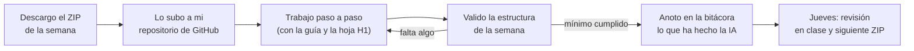
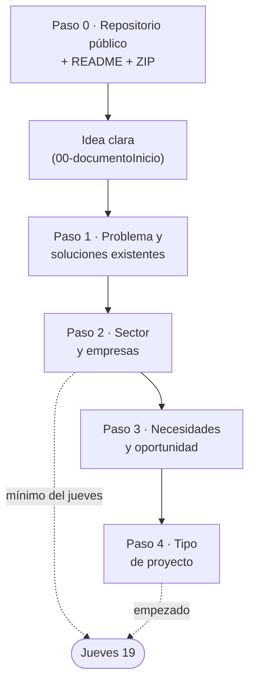
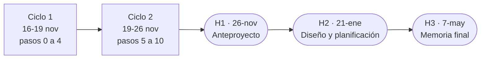

<div align="center">


# Proyecto intermodular de Desarrollo de Aplicaciones Web

**Tutoría y material del proyecto · 2.º DAW · CIFP Sectores Industriales y Servicios (Gijón) · Curso 2026-27**


</div>

---

<!-- ============================================================
     BLOQUE SEMANAL: se actualiza cada jueves al mandar el ZIP de la semana.
     Cambia: título, fechas, lista «Debes tener hecho» y enlace al ZIP.
     ============================================================ -->

## Esta semana · ciclo 1 de H1 · del lunes 16 al jueves 19 de noviembre

> [!IMPORTANT]
> **Qué tienes que tener hecho el jueves 19** (el paso a paso está en la [hoja del hito H1](docs/hitos/H1.md)):
>
> 1. **Tu repositorio nuevo en GitHub**, **público**, con un `README.md` inicial.
> 2. **El ZIP de la semana 1 subido** a tu repositorio (te mando el enlace por correo). Trae los tres primeros documentos de `docs/`, los agentes de OpenCode, la carpeta `asistenciaIA/` y un `.gitignore` que evita subir claves.
> 3. **Tu idea clara** en `docs/00-documentoInicio.md`.
> 4. **Pasos 1 y 2 terminados** (problema y soluciones que ya existen; sector y empresas) y **pasos 3 y 4 empezados**.
>
> Son unas **6 horas** entre lunes y jueves. Con lo que llegues basta: el jueves lo vemos juntos.

**→ [Empieza aquí: hoja del hito H1](docs/hitos/H1.md)** · **→ [Guía del paso 0: crear el repositorio y subir el ZIP](docs/guiaProyecto/como-se-hace/h1-0-repositorio-y-documentos-base.md)**

**Con ayuda de la IA (opcional):** instala OpenCode Desktop. La [guía H1-F](docs/guiaProyecto/como-se-hace/h1-f-opencode-desktop-y-el-proyecto.md) te lo explica paso a paso. No hace falta para el mínimo de esta semana.

### Cómo va la semana



**Cómo leerlo:** cada semana empieza con un ZIP. Lo subes a tu repositorio y trabajas los pasos de la hoja. Después compruebas que no falta nada (con la guía, `/validar`). Si falta algo, vuelves al trabajo. Si no, anotas en `asistenciaIA/bitacora.md` lo que ha hecho la IA. Y llegas a la revisión del jueves.

### Los pasos de esta semana



**Cómo leerlo:** se hacen en orden. El mínimo del jueves llega hasta el paso 2; los pasos 3 y 4 tienen que estar empezados.

---

## El curso en un vistazo



| Hito | Fecha | Qué se entrega |
|---|---|---|
| **H1** | 26-nov-2026 | Anteproyecto (RA1) |
| **H2** | 21-ene-2027 | Diseño y planificación (RA2 y RA3) |
| **H3** | 7-may-2027 | Memoria final y plan de seguimiento (RA4) |

**Cómo leerlo:** el curso avanza por ciclos semanales. Cada ciclo te acerca a una entrega: H1, H2 o H3.

Cada hito se reparte en **ciclos de jueves a jueves**. En cada ciclo te llegan dos cosas:

- **Un correo** que dice qué tienes que tener hecho.
- **Un ZIP** con los ficheros que añadir a tu repositorio.

Las fechas son provisionales hasta que se apruebe el calendario del centro. El detalle está en [fases-del-proyecto.md](docs/fases-del-proyecto.md).

---

## Cómo trabajamos

- **Tu proyecto vive en tu repositorio** de GitHub, **público**: no se sube a este. Nunca subas claves, contraseñas ni datos personales.
- **Cada tarea lleva una lista** de «Hecho cuando» y **una guía** con los pasos de cada elemento.
- **Trabajas con IA, pero la IA no hace tu trabajo ni te califica.** Los agentes de OpenCode vienen en el ZIP: `guia` te acompaña y `documentador` da forma al texto. **Anotas todo en `asistenciaIA/bitacora.md`.**
- **Siempre hay un plan B sin IA**: la documentación explica cada paso.
- **Ayuda por correo**, con respuesta en un máximo de **72 horas** → [cómo pedir ayuda](docs/guiaProyecto/contacto-y-ayuda.md). La sesión del **jueves** (16:25-17:20) es de revisión y dudas.

### Un ejemplo terminado: AriaScope

**[AriaScope](https://github.com/profeFPInfor/ariascope)** es el **proyecto de referencia**. Hace, semana a semana, los mismos pasos que tú. Allí ves cómo queda cada documento terminado. Mira también la carpeta `.opencode/` (los agentes, con su versión) y `asistenciaIA/` (la bitácora de lo que hace la IA).

---

## Dónde está cada cosa

| Necesito… | Voy a |
|---|---|
| Saber **qué hago esta semana**, paso a paso | [docs/hitos/H1.md](docs/hitos/H1.md) |
| **Crear mi repositorio** y subir el ZIP | [Guía del paso 0](docs/guiaProyecto/como-se-hace/h1-0-repositorio-y-documentos-base.md) |
| **Usar la IA** (OpenCode Desktop) con mi proyecto | [Guía H1-F](docs/guiaProyecto/como-se-hace/h1-f-opencode-desktop-y-el-proyecto.md) |
| **Cómo se hace** cada paso, con un ejemplo | [docs/guiaProyecto/](docs/guiaProyecto/README.md) |
| Ver el **calendario del curso** | [docs/fases-del-proyecto.md](docs/fases-del-proyecto.md) |
| **Pedir ayuda** | [docs/guiaProyecto/contacto-y-ayuda.md](docs/guiaProyecto/contacto-y-ayuda.md) |
| El resto de la documentación | [docs/README.md](docs/README.md) |

En este repositorio solo está lo de **esta semana** y el **adelanto de la siguiente**. Lo demás llega cuando toque.

```text
proyectosDAW/
├── README.md              ← estás aquí: qué toca esta semana
├── docs/                  ← guías de esta semana y adelanto de la siguiente
├── base-semanal/          ← los ZIP de cada semana y sus ficheros
└── LICENSE
```

---

## Licencia

© 2026 **Tever Díaz**. Todos los derechos reservados. Material para uso personal y educativo del alumnado del módulo; tu proyecto es de tu autoría. Detalles en [LICENSE](LICENSE).
