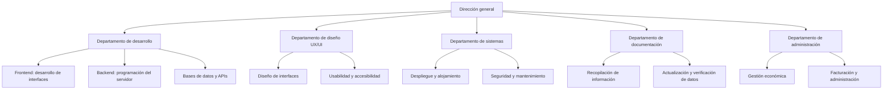

# 01 · Análisis y documentación inicial (RA1)

> **Plantilla.** Se entrega como **H1 el 26-nov-2026**. Cada apartado indica el criterio de evaluación (CE) que evidencia y qué se espera. Borra las notas en cursiva al rellenar.

## 1. Sector y empresas (CE 1a, 1b)
Tenno Helper es una aplicacion web relacionada al videojuego warframe siendo una herramienta complementaria pra dicho videojuego ofreciendo informacion y funcionalidades de gestion y ayuda a los jugadores.

En este paso dentro de warframe existe una comunidad que desarrolla y mantiene diferentes herramientas independientes.

Dentro del sector encontramos diferentes empresas/proyectos como:

|Empresa o Proyecto | Caracteristicas organizativas | Porducto o servicio|
|---|---|---|
|Digital Extremes| Empresa desarrolladora de videojuegos| Warframe, Warframe companion|
|Overframe|Proyecto comunitario especializado en warframe|Creacion, consulta, y publicaciond e builds|
|Warframe market| Plataforma comunitaria orientada al comercio entre jugadores| Consulta de precios y ofertas de comercio|
|AlecaFrame|Aplicacion independiente integrada en Overwolf| Gestion de inventario, seguimiento de fabricacion, reliquias y estadisticas|

ornanigrama:

## 2. Necesidades y oportunidades (CE 1c, 1d)
| Prioridad | Necesidad | Fuente |
|---|---|---|
| Muy Alta | Consultar donde conseguir armas, warframes, y recursos | https://wiki.warframe.com/ |
| Muy Alta | Gestionar el inventario personal | https://alecaframe.com/ |
| Alta | Consultar probabilidades de obtencion de objetos | https://www.warframe.com/droptables |
| Alta | Crear y guardar consfiguariones de equipamiento | https://overframe.gg/ |
| Baja | Facilitar comercio entre jugadores | https://warframe.market/ |

Siendo que hay varias herramientas comunitarias demuestra el interes de la comunidad en disponer de estos servicios complementarios, siendo que segun Steam Charts se registro una media de 60.730 jugadores simultaneos en steam https://steamcharts.com/app/230410

## 3. <a id="rf-03">Tipo de proyecto elegido (CE 1e)</a>

Tenno Helper sera una aplicacion web que agrupe las funciones de diferentes herramientas existentes del videojuego warframe la cual permitira a los usuarios consultar un catalogo de objetos, getsion de inventario, conocer fuentes y probabilidades de obtencion, realizar un seguimiento de objetos pendientes y crear y guardar builds.

Frente a otras opciones Tenno Helper sera una aplicacion que reunira difernetes funciones existentes esparcidas en diferentes aplicaciones web siendo una solucion completa frente al resto de herramientas comunitarias que desarrollan una unica funcion.

## 4. <a id="rf-04"> Requisitos y restricciones (CE 1f) </a>

| ID | Requisito | Tipo (funcional / no funcional / restricción) | Cómo se verifica |
|---|---|---|---|
| RF-01 | El sistema permitirá registrar usuarios e iniciar y cerrar sesión. | funcional | Crear una cuenta de prueba y comprobar el inicio y cierre de sesión. |
| RF-02 | El sistema mostrará un catálogo de armas, Warframes, mods y recursos. | funcional | Comprobar que aparecen las diferentes categorías y sus objetos. |
| RF-03 | El sistema permitirá consultar las fuentes y probabilidades de obtención de los objetos. | funcional | Consultar diferentes objetos y comprobar la información mostrada. |
| RF-04 | El sistema permitirá añadir, modificar y eliminar objetos del inventario personal. | funcional | Realizar las operaciones y comprobar los cambios. |
| RF-05 | El sistema permitirá marcar objetos pendientes y consultar los recursos que faltan para conseguirlos. | funcional | Añadir un objeto al seguimiento y comprobar sus requisitos. |
| RF-06 | El sistema permitirá crear, guardar y eliminar configuraciones de equipamiento (builds). | funcional | Crear una build, guardarla, recuperarla y eliminarla. |
| RNF-01 | La aplicación deberá adaptarse a ordenadores, tabletas y móviles. | no funcional | Probar la interfaz a 375 px, 768 px y 1366 px. |
| RNF-02 | Las consultas habituales deberán responder en menos de 2 segundos en condiciones normales. | no funcional | Medir los tiempos de respuesta. |
| RNF-03 | Las contraseñas deberán almacenarse mediante funciones de hash seguras. | no funcional | Comprobar que no se almacenan contraseñas en texto plano. |
| RNF-04 | La navegación permitirá acceder a las funcionalidades principales en un máximo de 3 interacciones desde el menú principal. | no funcional | Realizar pruebas de navegación. |
| RNF-05 | La información externa mostrará su procedencia y fecha de actualización cuando estén disponibles. | no funcional | Comprobar diferentes fichas de objetos. |
| REST-01 | La primera versión deberá estar terminada antes del 31 de marzo de 2027. | restricción | Comprobar la fecha de entrega. |
| REST-02 | Se utilizarán HTML5, CSS3, JavaScript, PHP y MySQL como tecnologías principales. | restricción | Revisar el código fuente. |
| REST-03 | Se utilizarán exclusivamente datos ficticios durante el desarrollo y las pruebas. | restricción | Revisar los registros de la base de datos. |
| REST-04 | La aplicación será independiente de Digital Extremes y no modificará datos del videojuego. | restricción | Revisar las integraciones implementadas. |
| REST-05 | El proyecto utilizará herramientas y servicios gratuitos. | restricción | Comprobar los costes de los servicios utilizados. |
| REST-06 | El chat y el comercio entre jugadores quedarán fuera de la primera versión. | restricción | Comprobar las funcionalidades implementadas. |

### Matriz de trazabilidad

| Objetivo | Requisito | Caso de uso | Pantalla o endpoint | Prueba o indicador |
|---|---|---|---|---|
| OBJ-01 Gestionar el acceso de los usuarios. | RF-01 | pendiente | pendiente | pendiente |
| OBJ-02 Consultar el catálogo de objetos del juego. | RF-02 | pendiente | pendiente | pendiente |
| OBJ-03 Consultar las fuentes y probabilidades de obtención. | RF-03 | pendiente | pendiente | pendiente |
| OBJ-04 Gestionar el inventario personal. | RF-04 | pendiente | pendiente | pendiente |
| OBJ-05 Realizar seguimiento de objetos pendientes. | RF-05 | pendiente | pendiente | pendiente |
| OBJ-06 Crear y gestionar configuraciones de equipamiento. | RF-06 | pendiente | pendiente | pendiente |
| OBJ-07 Garantizar la adaptación a diferentes dispositivos. | RNF-01 | pendiente | pendiente | pendiente |
| OBJ-08 Garantizar tiempos de respuesta adecuados. | RNF-02 | pendiente | pendiente | pendiente |
| OBJ-09 Proteger las credenciales de los usuarios. | RNF-03 | pendiente | pendiente | pendiente |
| OBJ-10 Facilitar la navegación por la aplicación. | RNF-04 | pendiente | pendiente | pendiente |
| OBJ-11 Garantizar la procedencia y actualización de la información. | RNF-05 | pendiente | pendiente | pendiente |

## 5. Obligaciones fiscales, laborales y de prevención (CE 1g)

Debido a que Tenno Helper es una aplicación complementaria basada en el videojuego Warframe, deberá respetar los derechos de propiedad intelectual y las condiciones de uso establecidas por Digital Extremes.

Entre las principales restricciones se encuentran:

No cobrar por el acceso a funcionalidades o contenidos relacionados con Warframe.
No incluir publicidad ni sistemas de monetización dentro de la aplicación.
No aceptar patrocinios ni obtener ingresos mediante colaboraciones comerciales relacionadas con el proyecto.
No vender recursos gráficos, modelos u otros contenidos protegidos del videojuego.
No utilizar los logotipos oficiales de Warframe o Digital Extremes sin autorización escrita.
Indicar claramente que Tenno Helper es un proyecto independiente y no está respaldado oficialmente por Digital Extremes.
Respetar las licencias de los recursos externos utilizados durante el desarrollo.
Por estas restricciones, Tenno Helper se desarrollará y distribuirá de forma completamente gratuita, sin ningún tipo de actividad comercial o monetización.

Normativa y condiciones aplicables:

Real Decreto Legislativo 1/1996, por el que se aprueba el texto refundido de la Ley de Propiedad Intelectual.
Política de contenido de Digital Extremes: https://www.warframe.com/es/contentpolicy
Acuerdo de licencia de usuario final (EULA): https://www.warframe.com/es/eula

## 6. Ayudas y subvenciones (CE 1h)

Para una posible puesta en marcha empresarial de Tenno Helper se encontró una ayuda del Principado de Asturias destinada a fomentar la creación de proyectos empresariales innovadores.

Cheque Emprendedor del Principado de Asturias

Organismo convocante: Consejería de Ciencia, Industria y Empleo del Principado de Asturias.

Finalidad: Favorecer la creación de iniciativas empresariales innovadoras mediante una ayuda económica destinada a personas que inicien una actividad por cuenta propia.

Cuantía: 10.000 euros.

Principales requisitos:

Ser emprendedor, reemprendedor o continuar una actividad empresarial mediante un relevo.
Disponer de un proyecto empresarial que haya sido monitorizado durante un mínimo de dos meses y calificado como innovador por un experto externo.
Haberse dado de alta como trabajador autónomo entre el 1 de septiembre de 2025 y el 31 de agosto de 2026.
Tener el domicilio fiscal en un concejo del Principado de Asturias.
Desarrollar personalmente la actividad empresarial.
Disponer de una página web, blog o perfil en una red social para la actividad.
Estar al corriente de las obligaciones tributarias y con la Seguridad Social.

Plazo de solicitud de la convocatoria de 2026: Desde el 14 de mayo hasta el 7 de septiembre de 2026.

Estado de la convocatoria: Cerrada. Por tanto, no es posible solicitar esta ayuda en la actualidad. Se podría estudiar una futura convocatoria si se decide poner en marcha Tenno Helper como actividad empresarial y se cumplen los requisitos correspondientes.

Aplicación al proyecto: Esta subvención podría resultar interesante para financiar los primeros gastos derivados de la puesta en marcha de Tenno Helper, como el alojamiento de la aplicación, el dominio, los servicios informáticos y otros recursos necesarios para su funcionamiento.

Fuente oficial: https://miprincipado.asturias.es/ast/-/dboid-6269000010924999807573

## 7. Guion de trabajo (CE 1i)

El desarrollo de Tenno Helper se organizará en diferentes fases, siguiendo una metodología incremental. Cada fase tendrá unos objetivos y unos resultados que deberán completarse antes de comenzar la siguiente.

### Planificación de las fases

| Fase | Periodo | Tareas principales | Resultado esperado |
|---|---|---|---|
| 1. Análisis y documentación | 24/11/2026 - 30/11/2026 | Análisis del sector, identificación de necesidades, definición de requisitos y planificación. | Documentación inicial del proyecto. |
| 2. Diseño del sistema | 01/12/2026 - 20/12/2026 | Diseño de la base de datos, diagramas, arquitectura de la aplicación y prototipos de interfaz. | Diseño técnico y visual. |
| 3. Desarrollo de la estructura | 21/12/2026 - 15/01/2027 | Configuración del entorno, creación de la base de datos, desarrollo del sistema de usuarios y estructura general. | Aplicación con estructura funcional y autenticación. |
| 4. Desarrollo de funcionalidades | 16/01/2027 - 28/02/2027 | Desarrollo del catálogo, inventario, consulta de obtención de objetos, seguimiento y creación de builds. | Funcionalidades principales implementadas. |
| 5. Pruebas y correcciones | 01/03/2027 - 15/03/2027 | Pruebas funcionales, comprobación de requisitos, corrección de errores y pruebas de adaptación a dispositivos. | Aplicación estable y validada. |
| 6. Documentación y entrega | 16/03/2027 - 31/03/2027 | Elaboración de la documentación final, revisión del proyecto y preparación de la entrega. | Primera versión terminada y documentada. |

### Hitos del proyecto

| Hito | Fecha | Descripción |
|---|---|---|

### Responsables

| Responsable | Funciones |
|---|---|
| Dirección y planificación | Organizar las tareas, establecer prioridades y controlar los plazos. |
| Desarrollo frontend | Implementar las interfaces mediante HTML5, CSS3 y JavaScript. |
| Desarrollo backend | Implementar la lógica del servidor y las funcionalidades mediante PHP. |
| Gestión de bases de datos | Diseñar y mantener la base de datos MySQL. |
| Diseño UX/UI | Diseñar las interfaces y garantizar una navegación sencilla. |
| Pruebas y documentación | Verificar el funcionamiento de la aplicación y mantener actualizada la documentación. |

Al estar unicamente desarrollado por una persona el proyecto sera completamente realizado por este mismo individuo

### Herramientas de organización

| Herramienta | Utilidad |
|---|---|
| Git y GitHub | Control de versiones y almacenamiento del código fuente. |
| Visual Studio Code | Entorno principal de desarrollo. |

## 8. Glosario

| Término | Definición | Sinónimos que NO uso |
|---|---|---|
| Tenno Helper | Aplicación web que reúne diferentes herramientas y funcionalidades de ayuda para los jugadores de Warframe. | Tenno Tools, Warframe Helper, TH | 
| Warframe | Videojuego desarrollado por Digital Extremes en el que se basa el proyecto. | WF, el juego, videojuego | 
| Objeto | Elemento del videojuego que aparece en el catálogo, como armas, Warframes, mods o recursos. | Ítem, artículo, elemento | 
| Inventario | Sección personal de cada usuario donde puede registrar y gestionar los objetos que posee en el videojuego. | Colección, almacén, mochila | 
| Build | Configuración de equipamiento de un Warframe o arma que incluye los mods seleccionados para personalizar sus características. | Montaje, setup, configuración de mods |

---

## Criterios de evaluación de este documento (RA1, texto literal)

- **1a)** Se han clasificado las empresas del sector por sus características organizativas y el tipo de producto o servicio que ofrecen.
- **1b)** Se han caracterizado las empresas tipo indicando la estructura organizativa y las funciones de cada departamento.
- **1c)** Se han identificado las necesidades más demandadas a las empresas.
- **1d)** Se han valorado las oportunidades de negocio previsibles en el sector.
- **1e)** Se ha identificado el tipo de proyecto requerido para dar respuesta a las demandas previstas.
- **1f)** Se han determinado las características específicas requeridas al proyecto.
- **1g)** Se han determinado las obligaciones fiscales, laborales y de prevención de riesgos y sus condiciones de aplicación.
- **1h)** Se han identificado posibles ayudas o subvenciones para la incorporación de nuevas tecnologías de producción o de servicio que se proponen.
- **1i)** Se ha elaborado el guión de trabajo que se va a seguir para la elaboración del proyecto.